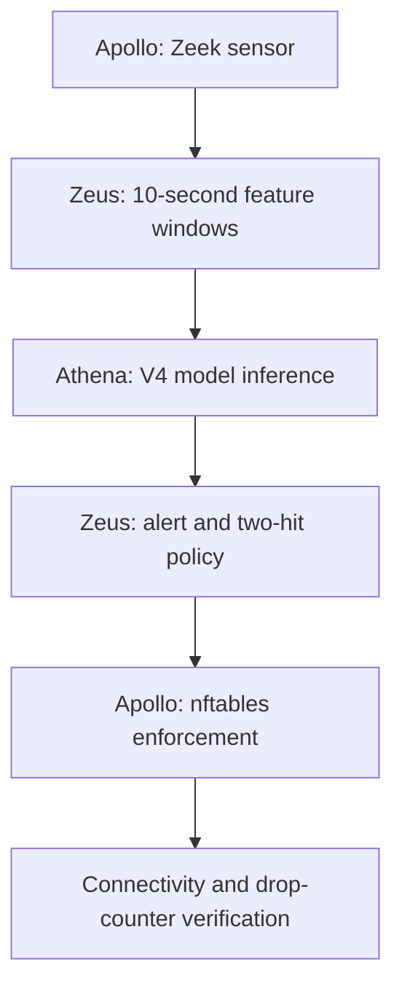

# AI-Assisted Intrusion Detection and Automated Response on Low-Cost Edge Hardware

**Master's computer science research project**  
**Wyatt Hackett — University of Arkansas at Pine Bluff (2026)**

## Overview

This repository documents the software developed and evaluated for an AI-assisted network intrusion detection and automated response system on low-cost edge hardware. The system analyzes Zeek network connection records, classifies source behavior using a trained machine-learning model, and can temporarily block sources that meet its response criteria.

The software was integrated into an **existing Raspberry Pi Kubernetes environment**. The original cluster infrastructure is not claimed as an original contribution of this project. The research contribution is the IDS software pipeline, distributed service integration, automated response logic, and controlled evaluation.

## System architecture

- **Apollo:** Network observation with Zeek and firewall rule enforcement with nftables.
- **Zeus:** Live controller, feature extraction, response decisions, and experimental orchestration.
- **Athena:** Hosts the model inference service (`v4_metrics_server.py`).
- **Prometheus/Grafana:** Resource and system monitoring.

The live pipeline forms **10-second, source-based traffic windows** with **16 behavioral features**. The deployed V4 classifier uses scikit-learn's **HistGradientBoosting**. The defense policy requires **two qualifying attack classifications within 60 seconds** before applying a temporary firewall block. This policy balances erroneous blocks against response delay; it is not instantaneous protection.

## Source tree

| Directory | Contents |
| --- | --- |
| [`model_pipeline/`](model_pipeline/) | Data preparation and model-training scripts |
| [`supporting/`](supporting/) | Feature and window-construction utilities |
| [`live_ids/`](live_ids/) | Live V4 controller, inference service, and service metrics |
| [`defense/`](defense/) | Alert/response policy and firewall enforcement |
| [`evaluation/`](evaluation/) | Controlled experiment orchestration and result summarization |

The source files were organized into these directories for publication. A few Python imports and startup settings were adjusted to match the publication layout; the classifier, feature and response algorithms were otherwise preserved. This is a **research code snapshot**, not a guaranteed turnkey or production-ready network defense product.

Some evaluation scripts reference tools, raw datasets, Kubernetes resources, or model artifacts from the original **complete** lab checkout that are not redistributed here. In particular, the 30-trial validation script references `tools/sync_v4_lab_firewall.sh`; the included script documents the methodology but **cannot be rerun from this archive alone**. The historical `run_formal_campaign.py` also references older V1/frozen artifacts and should not be mistaken for the final V4 trial runner.

## Limitations

- Results come from controlled scenarios and limited benign-traffic samples.
- The broad evaluation showed a specific detection failure on the ICMP burst workload (0/16).
- The two-hit policy and traffic-window pipeline introduce an end-to-end enforcement delay.
- External training/validation measurements are not directly interchangeable with live trial-level outcomes.
- The evaluation does not demonstrate superiority over an equivalent cloud deployment without a direct matched comparison.
- Some deployment scripts and experiment parameters require environment-specific adaptation.
