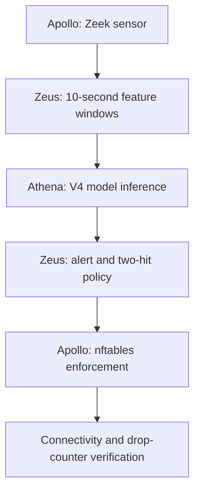

# AI-Assisted Intrusion Detection and Automated Response on Low-Cost Edge Hardware

**Master's computer science research project**  
**Wyatt Hackett — University of Arkansas at Pine Bluff (2026)**

## Overview

This repository documents the software developed and evaluated for an AI-assisted network intrusion detection and automated response system on low-cost edge hardware. The system analyzes Zeek network connection records, classifies source behavior using a trained machine-learning model, and can temporarily block sources that meet its response criteria.

The software was integrated into an **existing Raspberry Pi Kubernetes environment**. The original cluster infrastructure is not claimed as an original contribution of this project. The research contribution is the IDS software pipeline, distributed service integration, automated response logic, and controlled evaluation.

## System architecture

- **Apollo:** Network observation with Zeek and firewall rule enforcement with nftables.
- **Zeus:** Live controller, feature extraction, response decisions, and experimental orchestration.
- **Athena:** Hosts the model inference service (`v4_metrics_server.py`).
- **Prometheus/Grafana:** Resource and system monitoring.

The live pipeline forms **10-second, source-based traffic windows** with **16 behavioral features**. The deployed V4 classifier uses scikit-learn's **HistGradientBoosting**. The defense policy requires **two qualifying attack classifications within 60 seconds** before applying a temporary firewall block. This policy balances erroneous blocks against response delay; it is not instantaneous protection.

## Source tree

| Directory | Contents |
| --- | --- |
| [`model_pipeline/`](model_pipeline/) | Data preparation and model-training scripts |
| [`supporting/`](supporting/) | Feature and window-construction utilities |
| [`live_ids/`](live_ids/) | Live V4 controller, inference service, and service metrics |
| [`defense/`](defense/) | Alert/response policy and firewall enforcement |
| [`evaluation/`](evaluation/) | Controlled experiment orchestration and result summarization |
| [`results/`](results/) | Aggregate results from the final evaluation campaigns |

The source files were organized into these directories for publication. A few Python imports and startup settings were adjusted to match the publication layout; the classifier, feature and response algorithms were otherwise preserved. This is a **research code snapshot**, not a guaranteed turnkey or production-ready network defense product.

Some evaluation scripts reference tools, raw datasets, Kubernetes resources, or model artifacts from the original **complete** lab checkout that are not redistributed here. In particular, the 30-trial validation script references `tools/sync_v4_lab_firewall.sh`; the included script documents the methodology but **cannot be rerun from this archive alone**. The historical `run_formal_campaign.py` also references older V1/frozen artifacts and should not be mistaken for the final V4 trial runner.

## Controlled experimental evaluation

Two distinct evaluations were performed. Their trial populations and evaluation objectives differ, so their rates should **not** be combined into one aggregate accuracy claim.

| Outcome | Broad evaluation | Focused defense validation |
| --- | ---: | ---: |
| Total controlled trials | 160 | 30 |
| Attack trials | 128 | 25 |
| Benign trials | 32 | 5 |
| Attacks detected | 108/128 (84.38%) | 24/25 (96%) |
| Attacks with recorded enforcement/mitigation | 102/128 (79.69%) | 22/25 (88%) |
| Observed benign false positives/false blocks | 0/32 | 0/5 |

In the broad evaluation, **140/160 trials (87.50%)** had correct trial-level outcomes. Detection performance varied by scenario: the system detected **0/16 ICMP burst trials**, an important limitation. No observed false positives in the tested benign scenarios does **not** establish a zero false-positive rate on unseen networks.

### Response latency

Latency metrics describe different stages of the pipeline:

| Metric | Evaluation | Observed mean |
| --- | --- | ---: |
| Per-trial inference time (159 available measurements) | Broad | 25.96 ms |
| Detection delay on detected attacks | Broad | 45.30 s |
| Enforcement delay on successfully enforced attacks | Broad | 53.23 s |
| Defense-action latency (22 measured events) | Focused | 197.295 ms |
| Traffic-to-observed-block latency (22 successful blocks) | Focused | 40.218 s |

**Important:** The roughly 197 ms defense-action measurement is **not** the total time from attack traffic to an observed block. The latter averaged roughly 40.22 seconds in the focused validation.

In the focused validation, mitigation was checked using attacker connectivity, benign-control connectivity, and firewall packet-drop evidence. These findings apply to the controlled testbed and do not establish readiness for an unrestricted campus network.

### Result files

- [Broad 160-trial summary](results/broad_160/summary.txt)
- [Focused 30-trial summary](results/focused_30/final_summary.txt)
- [Focused latency summary](results/focused_30/latency_summary.csv)

## Reproduction and deployment notes

See [publication notes](docs/PUBLICATION_NOTES.md) for a transparent description of the differences between the original lab checkout and this public snapshot. See the [publishing guide](docs/PUBLISHING_GUIDE.md) for creating a repository and referencing a stable release in the research paper.

The software depends on a Zeek traffic source, a running inference service, compatible training artifacts, and an enforcement environment with appropriate firewall permissions. The original deployment used Kubernetes and machine-specific service addresses. Consult the code and adapt configuration to your **authorized testing environment** before attempting execution.

### Python and runtime requirements

Python 3.13.5 and the library versions listed in [`requirements.txt`](requirements.txt) reflect the recovered Athena V4 Python environment; individual components also require Zeek, `kubectl`, `nftables`, and other system tools. The machine-learning training scripts additionally require source datasets that are **not** bundled here. Dependency installation alone will not reproduce the cluster.

### Environment configuration

See [`.env.example`](.env.example) for the required lab-specific variables. They are **examples**, not working credentials or default network targets.

| Setting | Role |
| --- | --- |
| `AI_IDS_V4_SERVICE_IP`, `AI_IDS_V4_SERVICE_PORT` | Address of the authorized inference service |
| `AI_IDS_MODEL_PATH` | Path to the frozen V4 model artifact on the inference node |
| `AI_IDS_ALLOWED_CIDR` | **Required** authorized IPv4 pod network that can be blocked; enforcement fails closed without it |
| `AI_IDS_INFRA_TUNNEL_IP` | Infrastructure address excluded from source classification |
| `AI_IDS_PROJECT_ROOT` | Complete local lab checkout and experiment data location |
| `AI_IDS_INFERENCE_URL` | Base URL for the original focused validation script |
| `AI_IDS_ALLOW_LAB_TESTS` | Must be explicitly set to `YES` for the destructive lab campaign scripts |

The publication launcher `live_ids/run_live_v4_controller.sh` expects the service address to be configured; it invokes `python -m live_ids.live_v4_controller` from this source layout. Do not enable firewall enforcement without first reviewing the permitted CIDR, infrastructure exclusions, permissions, and network topology.

The inference service loads a V4 `joblib` model artifact and verifies its recorded SHA-256 fingerprint before loading it. The model binary and third-party training datasets are not included here. The training code and source-specific data preparation scripts are provided for research inspection. The original artifact's hash is retained in the source for provenance, but the model itself is required for actual inference.

The experiment scripts include controlled traffic-generation scenarios. **Run them only on networks and systems you own or are explicitly authorized to test.**

**Security note:** The V4 HTTP inference service and experiment harness were developed inside a controlled lab. Do not expose these endpoints directly to an untrusted network or run experiment scripts against third-party hosts.

## Limitations

- Results come from controlled scenarios and limited benign-traffic samples.
- The broad evaluation showed a specific detection failure on the ICMP burst workload (0/16).
- The two-hit policy and traffic-window pipeline introduce an end-to-end enforcement delay.
- External training/validation measurements are not directly interchangeable with live trial-level outcomes.
- The evaluation does not demonstrate superiority over an equivalent cloud deployment without a direct matched comparison.
- Some deployment scripts and experiment parameters require environment-specific adaptation.

## Citation

When referencing this project in a paper, cite the public repository's **release tag or archived version**, together with its URL and access date or DOI as required by the citation style. Add the final GitHub URL after publication.

**Suggested software title:** *AI-Assisted Intrusion Detection and Automated Response on Low-Cost Edge Hardware* (Wyatt Hackett, 2026).

## Acknowledgment

This project was conducted as master's-level research at the University of Arkansas at Pine Bluff. The IDS and automated response software were developed and evaluated using an existing Raspberry Pi Kubernetes testbed.
